## Hi, I'm Ashim

I take products from idea to production: the interface, the API, the database and, where it makes the software
genuinely more useful, the AI. I lead a development team at **Codesc Nepal**, and I founded
**[Your Tech Mitra Pvt. Ltd.](https://mekmitra.com/)**, the company behind **MekMitra**, a garage management
SaaS built for auto workshops in Nepal.

- I design schemas and APIs for ERP, inventory, logistics, HR and CRM systems.
- I build the shared component libraries and import/export tools that teams reuse across projects.
- I review pull requests, mentor newer developers and ship features from requirements to deployment.
- I speak Nepali, Newari, Hindi and English.

|  | What I work with |
| :-- | :-- |
| **Frontend** | React · Next.js · TypeScript · Tailwind CSS · Ant Design · Three.js |
| **Backend** | Django · Django REST Framework · Python · Node.js · Express |
| **Data** | PostgreSQL · MongoDB · MySQL |
| **Shipping** | Git · Docker · Linux · code review · technical documentation |
| **Product** | Team leadership · SaaS · product management |

## The workspace

Every commit message in that office is the kind I actually write: conventional commits, small and reviewed.

## MekMitra

> Replace paper job cards and Excel sheets in Nepal's auto garages with workshop software built for Nepal:
> VAT-aware invoicing, NPR pricing and support from the founder himself.

I design, build, host and support it myself. It covers the whole workshop lifecycle: digital job cards,
Nepal VAT invoicing and IRD VAT reports, AMC memberships, multi-branch inventory, staff roles, a gate pass
system, fleet accounts, a customer portal, SMS alerts, a QR vehicle health page and an SOS breakdown feature.
There is a **Free Forever** plan, no credit card needed.

**[Try MekMitra](https://mekmitra.com/)**

## Selected work

Most of this is client work, so the code is private. Each one shipped to production.

| Project | What it is | Stack |
| :-- | :-- | :-- |
| **MekMitra** | Garage management SaaS (founder, designer, developer) | React · DRF · PostgreSQL |
| **CIMEX BYD ERP** | ERP for a vehicle dealer (team lead) | React · DRF · PostgreSQL · Ant Design |
| **Motocore** | Dealership management system | React · DRF · PostgreSQL |
| **Shasheela Motors** | CRM and business intelligence | React · Django · PostgreSQL |
| **See Car** | Vehicle reconditioning ERP | React · DRF · PostgreSQL |
| **Tapai Ko Bazar** | Vehicle financing ERP | React · DRF · PostgreSQL |
| **Swiss Time Pieces** | Inventory management | React · DRF · PostgreSQL |
| **Baltra Nepal** | CRM tools | React · Django · MongoDB |

## Public experiments

| Repo | About |
| :-- | :-- |
| [`3d_Portfolio`](https://github.com/Ashim156/3d_Portfolio) | A 3D portfolio in JavaScript |
| [`FlyingBird-three.js`](https://github.com/Ashim156/FlyingBird-three.js) | A flying bird scene with Three.js |
| [`mern-estate`](https://github.com/Ashim156/mern-estate) | A MERN stack real estate app |
| [`Cafe`](https://github.com/Ashim156/Cafe) | A Figma design turned into a React site |

